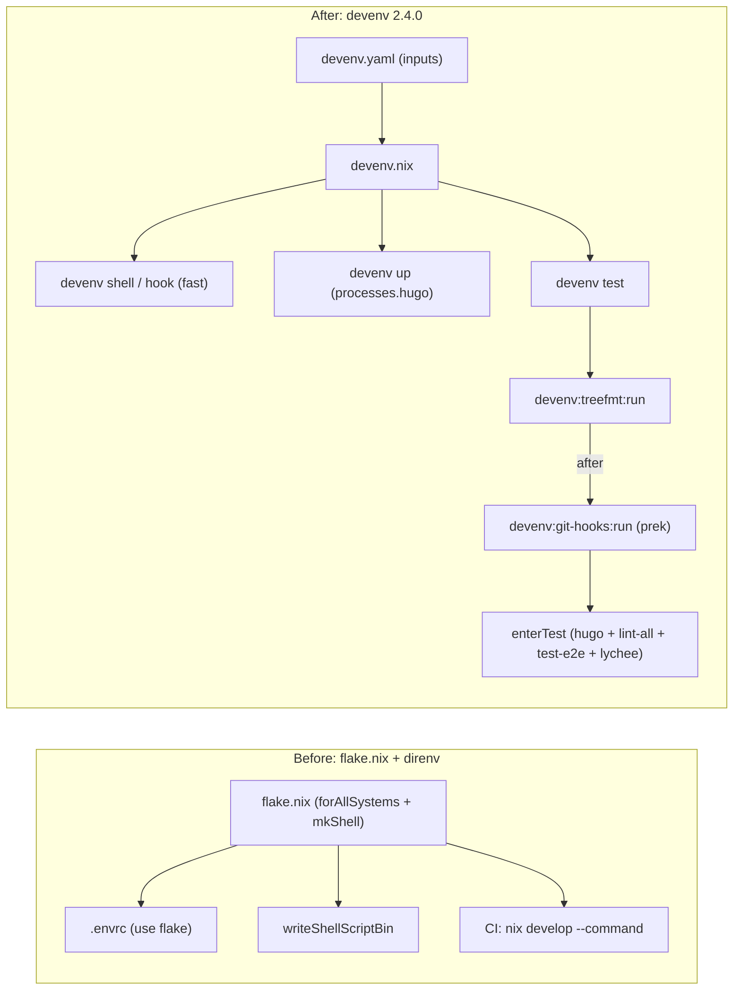

In a [previous post](/en/posts/2026/devshell-nix-flakes-direnv/), I set up this
blog's development environment using a `flake.nix` and `direnv` (`use flake`).
That worked fine as long as the shell only needed `hugo`, `git`, and
`markdownlint-cli2`.

Once I wanted a full set of formatters and linters (`nixfmt`, `statix`,
`deadnix`, `yamlfmt`, `prettier`, `yamllint`, `actionlint`, `typos`, `gitleaks`,
`lychee`) wired into pre-commit hooks and CI, maintaining a hand-rolled
`flake.nix` stopped paying for itself. I migrated the repository to **devenv
2.4.0**.

Here is what changed, the four failures hit on the first `devenv test` run, and
when I would or would not make the same trade.

## The starting point: 59 lines of Nix boilerplate

The previous `flake.nix` had to manually handle `forAllSystems` across four
architectures, `pkgs.mkShell`, `writeShellScriptBin` wrappers, and `shellHook`:

```nix
# Excerpt from the previous flake.nix (59 lines total)
{
  inputs.nixpkgs.url = "github:NixOS/nixpkgs/nixos-unstable";

  outputs = { self, nixpkgs }:
    let
      allSystems = [
        "x86_64-linux" "aarch64-linux" "x86_64-darwin" "aarch64-darwin"
      ];
      forAllSystems = f: nixpkgs.lib.genAttrs allSystems (system: f {
        pkgs = import nixpkgs { inherit system; };
      });
    in {
      devShells = forAllSystems ({ pkgs }: {
        default = pkgs.mkShell {
          packages = with pkgs; [
            hugo git markdownlint-cli2
            (writeShellScriptBin "build-hugo" ''exec hugo --gc --minify "$@"'')
          ];
        };
      });
    };
}
```

Alongside it, `.envrc` held `use flake`, `.gitignore` ignored `.direnv/`, and
GitHub Actions workflows ran `nix develop --command ...` with
`cachix/install-nix-action@v30` and `magic-nix-cache-action`.

Wiring `treefmt-nix` and `git-hooks.nix` directly into `flake.nix` (for
instance with `flake-parts`) is certainly possible, but it meant maintaining
Nix glue code in a repository whose job is to publish Markdown posts.

## Why `devenv` instead of extending `flake.nix`

Two options were on the table:

1. **Keep `flake.nix` + `direnv`** and add `flake-parts`, `treefmt-nix`, and
   `git-hooks.nix`. Pros: pure Nix Flakes, no extra CLI. Cons: manual wiring for
   `checks`, `devShells`, and `formatter`, with no built-in process manager or
   test runner.
2. **Switch to `devenv 2.4.0`**. Pros: `treefmt`, `git-hooks`, `scripts`,
   `processes` (`devenv up`), and `enterTest` are top-level options in
   `devenv.nix`, and `devenv hook` replaces `direnv` for shell auto-activation.
   Cons: both local machines and CI runners now depend on the `devenv` CLI.

For a personal blog where tooling maintenance should stay minimal, I picked
`devenv`. Here is why it beats a hand-rolled `flake.nix` as soon as a project
needs more than two packages:

- **One typed module instead of glue code**: packages, env vars, scripts,
  background processes (`devenv up`), formatters (`treefmt`), hooks
  (`git-hooks`), and tests (`enterTest`) live in one schema-checked Nix
  module, without wiring `flake-parts`, `devShells`, `checks`, and `formatter`
  by hand.
- **A unified task DAG (`devenv test`)**: `devenv` keeps `devenv shell` fast
  by skipping `enterTest` and `git-hooks:run` on shell entry, while `devenv
  test` runs setup + hooks + tests and lets you order tasks with `after` or
  `wantedBy`.
- **Local and CI parity**: the exact same hooks (`pkgs.prek`, aware of linked
  Git worktrees) and scripts run on your laptop and in GitHub Actions via
  `devenv shell -- ...`.



## Migration mechanics

### 1. Remove `direnv` and `flake.nix`

I deleted `.envrc`, `flake.nix`, and `flake.lock`, and updated `.gitignore` to
replace `.direnv/` with `.devenv*`, `devenv.local.nix`, `devenv.local.yaml`,
`.pre-commit-config.yaml`, `__pycache__/`, and `static/vendor/`.

### 2. Declare inputs in `devenv.yaml`

```yaml
# yaml-language-server: $schema=https://devenv.sh/devenv.schema.json
inputs:
  nixpkgs:
    url: github:cachix/devenv-nixpkgs/rolling
  treefmt-nix:
    url: github:numtide/treefmt-nix
    inputs:
      nixpkgs:
        follows: nixpkgs
  git-hooks:
    url: github:cachix/git-hooks.nix
    inputs:
      nixpkgs:
        follows: nixpkgs
```

### 3. Configure `devenv.nix`

`devenv.nix` centralizes packages, `treefmt` (Nix + YAML + Ruff + Prettier
scoped to JSON so it does not clash with `yamlfmt` or `markdownlint-cli2`),
pre-commit hooks, scripts (`build-hugo`, `lint-all`, `test-e2e`, `check-links`,
`test-all`), the local `processes.hugo` server (`devenv up`), and `enterTest`:

```nix
{ pkgs, lib, ... }:
{
  packages = with pkgs; [
    hugo git markdownlint-cli2 yamllint actionlint typos gitleaks lychee ruff
    chromium (python3.withPackages (ps: [ ps.playwright ]))
  ];

  processes.hugo.exec = "hugo server -D --buildFuture --navigateToChanged";

  treefmt = {
    enable = true;
    config = {
      settings.global.excludes = [
        "themes/**" "public/**" "resources/**" "static/vendor/**"
        "devenv.lock" ".devenv/**"
      ];
      programs = {
        nixfmt.enable = true;
        statix.enable = true;
        deadnix.enable = true;
        yamlfmt.enable = true;
        ruff-format.enable = true;
        ruff-check.enable = true;
        prettier = {
          enable = true;
          includes = [ "*.json" ];
        };
      };
    };
  };
}
```

### 4. Local preview with `devenv up`

Before publishing, I use [devenv](https://devenv.sh/)'s process manager to
start a local Hugo preview server with one command:

```sh
devenv up
```

In `devenv.nix`, `processes.hugo.exec` runs `hugo server -D --buildFuture
--navigateToChanged`. In daily writing, that beats typing flags by hand:

- **`-D` and `--buildFuture`** render drafts and future-dated posts right away
  while you are still editing them.
- **`--navigateToChanged`** reloads and jumps straight to whichever post you
  just saved in the browser.
- **One entry point (`devenv up`)**: if you later add an asset watcher or
  another helper process, the command stays the same, and the native TUI
  guards against accidental exits on the first `Ctrl-C` (confirm with `q` or a
  second `Ctrl-C`).

### 5. Playwright E2E, `axe-core`, and CDN-free Mermaid

To avoid any external CDN dependency, `devenv.nix` fetches `mermaid@11.4.1`
and `axe-core@4.10.2` via `pkgs.fetchurl` (pinned by Nix hash). `sync-vendor`
copies `mermaid.min.js` into gitignored `static/vendor/`, and
`tests/e2e_site.py` checks all `27` built pages in headless Chromium for valid
RSS/JSON feeds, Mermaid SVG rendering, light/dark toggle, mobile layout
(`390x844`, no overflow), and zero critical `axe-core` violations.

### 6. Update GitHub Actions CI

In `.github/workflows/ci.yml` and `gh-pages.yml`, `nix develop --command` was
replaced with `cachix/install-nix-action@v31`, `cachix/cachix-action@v16`
(`name: devenv`), `nix profile add nixpkgs#devenv`, and `devenv --no-tui shell
-- ...`. A weekly `.github/workflows/devenv-update.yml` workflow runs
`devenv --no-tui update` and opens a pull request for `devenv.lock`.

## What went wrong on the first `devenv test`

The migration did not pass on the first try. Four concrete issues surfaced
immediately during `devenv --no-tui test`:

### 1. `treefmt` SQLite cache lock contention

Enabling both `treefmt.enable = true` and `git-hooks.hooks.treefmt.enable =
true` caused `devenv test` to run `devenv:treefmt:run` and `devenv:git-hooks:run`
concurrently:

```text
• Running devenv:treefmt:run
• Running devenv:git-hooks:run
  Error: failed to open cache: failed to open cache db at
  /home/julien/.cache/treefmt/eval-cache/93259beba49ecca9ea36bdebe0772ee51d3dfd32d7a66e557ea104f08fc26cbe.db: timeout
✖ Running devenv:treefmt:run in 994ms (failed)
```

Ordering the two tasks in `devenv.nix` solved it in one line:

```nix
tasks."devenv:git-hooks:run".after = [ "devenv:treefmt:run" ];
```

With that dependency in place, `devenv:treefmt:run` finishes first (`16.5ms`)
and `devenv:git-hooks:run` runs right after without lock contention.

### 2. `typos` on a bilingual blog and a GeoJSON file

`typos` only ships an English dictionary. It immediately exited with code `2` on
`static/assets/vendee.json` (French town names like `La Roche-sur-Yon` flagged
as `sur` -> `sure`), `hugo.yaml`, and French posts (`Tutoriel` -> `Tutorial`,
`environnement` -> `environment`).

I added `_typos.toml` to exclude French-only directories/files and data assets
(`themes/`, `public/`, `resources/`, `static/assets/`, `*.fr.md`,
`content/posts/old_posts/`, `content/posts/2025/`, `hugo.yaml`, `devenv.lock`),
while keeping spell-checking active on English posts (`*.en.md`), Nix files,
and CI workflows.

### 3. `yamllint` on YAML snippets inside blog posts

Running `yamllint` at the repo root without a config checked example YAML files
embedded in blog post bundles (`content/posts/2025/.../config.yml`), and flagged
GitHub Actions' `on:` key (`truthy`) as well as missing `---` document headers.

A `.yamllint.yaml` config ignores `content/`, `themes/`, `public/`,
`resources/`, and `.devenv/`, disables `document-start` and `line-length`, and
allows `on` under `truthy`.

### 4. `gitleaks` in hooks vs `--no-git`

Running `gitleaks detect --no-git` manually scanned `44.59 MB` (including
`.devenv/` and `themes/`) in `3.46s` and reported 3 findings. By contrast,
`git-hooks.hooks.gitleaks` runs `gitleaks git --pre-commit --redact --staged
--verbose`, scanning only staged Git changes and passing cleanly.

## Results: before and after

| Aspect | Before (`direnv` + `flake.nix`) | After (`devenv 2.4.0`) |
| --- | --- | --- |
| Auto-activation | `.envrc` + `direnv` + `nix-direnv` | `devenv hook` + `devenv allow` |
| Formatters & linters | `markdownlint-cli2` only | `treefmt` + 8 `git-hooks` + `test-e2e` + `lychee` |
| Local server | manual `hugo server` | `devenv up` (`processes.hugo`, quit via `q` or 2× Ctrl-C) |
| Pre-commit hooks | None | `pkgs.prek` by default, linked-worktree aware |
| Shell entry | `nix develop` | `devenv shell` (skips `enterTest` and `git-hooks:run`) |
| Test suite | `nix develop --command test-all` | `devenv --no-tui test` (`21.5s` for hooks) |
| GitHub Actions CI | `nix develop` + `magic-nix-cache` | `cachix/cachix-action@v16` (`devenv`) |

## Across four repositories

Between November 15 and 25, 2026, I ran the same migration on four repos:

| Repo | Stack | Config delta | Notable details |
| --- | --- | --- | --- |
| `stl23mf` | Rust | `flake.nix` + `.envrc` → `devenv.nix` (36 l.) | `languages.rust`, 17 files formatted |
| `cad-killer` | JS/TS/Bun/Playwright | `flake.nix` (32 l.) → `devenv.nix` (284 l.) | `treefmt --ci`, Playwright NixOS/CI |
| `home-lab` | K8s/Python/TF/Bash | `flake.nix` (451 l.) → `devenv.nix` (315 l.) | 50 files fixed by `treefmt` |
| This blog | Hugo/YAML/Python | `flake.nix` (59 l.) → `devenv.nix` | `lychee`, `test-e2e`, `_typos.toml` |

Two takeaways: large `flake.nix` files shrink (`451` → `315` lines on
`home-lab`), while small ones grow because adding formatters, hooks, and tests
becomes cheap—and immediately surfaces accumulated lint debt.

## Handling secrets: SOPS + `ssh-to-age` vs `dotenv` / `secretspec`

As covered in [my `sops-nix` post](/en/posts/2026/sops-nix-gestion-secrets/),
an infrastructure repository like `home-lab` needs encrypted secrets stored in
Git. Inside `devenv`, three options cover different needs:

| Approach | Storage | Committed in Git | Best fit |
| --- | --- | --- | --- |
| `dotenv.enable` | Unencrypted local `.env` | No (`.gitignore`) | Throwaway local env vars |
| `secretspec` (native `devenv`) | External provider (keyring, etc.) | Schema only | Per-developer tokens |
| `sops` + `age` + `ssh-to-age` | Encrypted `*.enc.yaml` files | Yes (Age public keys) | Shared infra / GitOps |

In `home-lab/devenv.nix`, I kept `sops`, `age`, and `ssh-to-age` in `packages`
with a small Nix helper reused in both `enterShell` and scripts
(`edit-secrets`, `reencrypt-secrets`, `apply-playbooks`):

```nix
let
  sopsAgeKeyInit = ''
    if [ -z "''${SOPS_AGE_KEY:-}" ] && [ -f "$HOME/.ssh/id_ed25519" ]; then
      SOPS_AGE_KEY="$(ssh-to-age -private-key -i "$HOME/.ssh/id_ed25519" 2>/dev/null || true)"
      export SOPS_AGE_KEY
    fi
  '';
in
{
  packages = with pkgs; [ sops age ssh-to-age ];
  scripts.edit-secrets.exec = ''
    set -euo pipefail
    ${sopsAgeKeyInit}
    sops "''${1:-freebox/secrets.enc.yaml}"
  '';
  enterShell = ''
    ${sopsAgeKeyInit}
  '';
}
```

Injecting `${sopsAgeKeyInit}` inside the scripts as well as `enterShell`
matters when invoking `devenv shell -- edit-secrets` from a non-interactive
shell or editor, while `git-hooks.hooks.gitleaks` acts as a safety net against
committing plaintext secrets.

## Limitations and whether I would do it again

I would make this switch again for any project with CI linters and local
services, with three caveats worth knowing up front:

1. **Offline locking fails before `devenv.lock` exists**: without an existing
   `devenv.lock` or network access to `github.com`, `devenv` cannot resolve
   `github:cachix/devenv` or `devenv-nixpkgs`. Generate and commit `devenv.lock`
   while online.
2. **CI depends on `devenv`**: runners must install `devenv` (`nix profile add
   nixpkgs#devenv`), whereas `nix develop` only required Nix.
3. **`typos` is English-only**: on a bilingual FR/EN site, `_typos.toml`
   exclusions need to be maintained so French prose does not block commits.

If your `flake.nix` only exposes two packages with no formatters or hooks,
keeping `flake.nix` + `direnv` is lighter. Once you want `treefmt`,
`git-hooks`, and a unified `test` entry point across local dev and CI, `devenv`
removes a lot of Nix boilerplate.

## Further reading

- [devenv official website](https://devenv.sh/) and
  [`cachix/devenv` on GitHub](https://github.com/cachix/devenv)
- [`processes` documentation](https://devenv.sh/processes/) (`devenv up`)
- [`treefmt` integration](https://devenv.sh/integrations/treefmt/)
- [`git-hooks` integration](https://devenv.sh/git-hooks/)
- [`tasks` documentation](https://devenv.sh/tasks/) (`after`, `wantedBy`)
