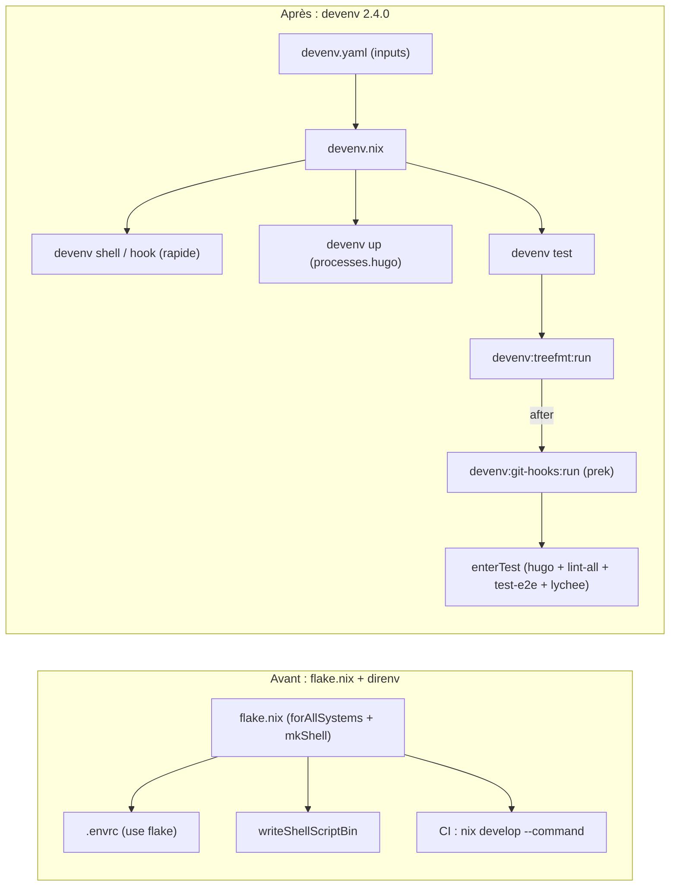

Dans un [article précédent](/posts/2026/devshell-nix-flakes-direnv/), j'avais
mis en place un environnement de développement pour ce blog avec un `flake.nix`
et `direnv` (`use flake`). Ça fonctionnait bien tant qu'il ne s'agissait que de
fournir `hugo`, `git` et `markdownlint-cli2`.

Dès que j'ai voulu ajouter un vrai jeu de formateurs et de linters (`nixfmt`,
`statix`, `deadnix`, `yamlfmt`, `prettier`, `yamllint`, `actionlint`, `typos`,
`gitleaks`, `lychee`) et les brancher sur les hooks pre-commit et la CI, le
`flake.nix` manuel a commencé à montrer ses limites. J'ai donc migré le dépôt
vers **devenv 2.4.0**.

Voici exactement ce qui a changé, les erreurs rencontrées au premier
`devenv test`, et dans quels cas je referais ce choix.

## Le point de départ : 59 lignes de boilerplate Nix

L'ancien `flake.nix` devait gérer manuellement la boucle `forAllSystems` sur
quatre architectures, `pkgs.mkShell`, les scripts via `writeShellScriptBin` et
le `shellHook` :

```nix
# Extrait de l'ancien flake.nix (59 lignes au total)
{
  inputs.nixpkgs.url = "github:NixOS/nixpkgs/nixos-unstable";

  outputs = { self, nixpkgs }:
    let
      allSystems = [
        "x86_64-linux" "aarch64-linux" "x86_64-darwin" "aarch64-darwin"
      ];
      forAllSystems = f: nixpkgs.lib.genAttrs allSystems (system: f {
        pkgs = import nixpkgs { inherit system; };
      });
    in {
      devShells = forAllSystems ({ pkgs }: {
        default = pkgs.mkShell {
          packages = with pkgs; [
            hugo git markdownlint-cli2
            (writeShellScriptBin "build-hugo" ''exec hugo --gc --minify "$@"'')
          ];
        };
      });
    };
}
```

À côté, `.envrc` contenait `use flake`, `.gitignore` ignorait `.direnv/`, et les
workflows GitHub Actions lançaient `nix develop --command ...` avec
`cachix/install-nix-action@v30` et `magic-nix-cache-action`.

Ajouter `treefmt-nix` et `git-hooks.nix` dans ce `flake.nix` était possible
(via `flake-parts` par exemple), mais cela voulait dire maintenir de la
plomberie Nix d'assemblage dans un dépôt qui ne sert qu'à publier des articles
en Markdown.

## Pourquoi `devenv` plutôt qu'un `flake.nix` enrichi

Deux options existaient :

1. **Garder `flake.nix` + `direnv`** et ajouter `flake-parts`, `treefmt-nix` et
   `git-hooks.nix`. Avantage : Nix Flakes pur, aucun outil supplémentaire.
   Inconvénient : beaucoup de câblage manuel (`checks`, `devShells`,
   `formatter`) et pas de gestion native des processus locaux ni de `devenv test`.
2. **Basculer vers `devenv 2.4.0`**. Avantage : `treefmt`, `git-hooks`,
   `scripts`, `processes` (`devenv up`) et `enterTest` sont des options de
   premier niveau dans `devenv.nix`, et `devenv hook` remplace `direnv` pour
   l'auto-activation du shell. Inconvénient : ajout d'une dépendance à l'outil
   `devenv` en local et en CI.

Pour un blog personnel où la maintenance de l'outillage doit rester minimale,
j'ai choisi `devenv`. Voici ce qui le rend concrètement supérieur à un
`flake.nix` manuel dès qu'un projet dépasse le stade de deux paquets :

- **Un seul modèle déclaratif** : paquets, variables, scripts, processus
  (`devenv up`), formateurs (`treefmt`), hooks (`git-hooks`) et tests
  (`enterTest`) vivent dans le même module Nix typé, sans devoir assembler
  `flake-parts`, `devShells`, `checks` et `formatter` à la main.
- **Un graphe de tâches unifié (`devenv test`)** : `devenv` sépare l'entrée
  rapide dans le shell (`devenv shell`, qui n'exécute pas `enterTest` ni
  `git-hooks:run`) de la validation complète (`devenv test`), tout en
  permettant d'ordonner les tâches entre elles via `after` / `wantedBy`.
- **Reproductibilité locale et CI alignées** : les mêmes hooks (`pkgs.prek`,
  compatibles avec les worktrees Git liés) et les mêmes scripts tournent sur
  la machine de développement et dans GitHub Actions via `devenv shell -- ...`.



## La migration en pratique

### 1. Nettoyer `direnv` et `flake.nix`

J'ai supprimé `.envrc`, `flake.nix` et `flake.lock`, puis mis à jour
`.gitignore` pour remplacer `.direnv/` par `.devenv*`, `devenv.local.nix`,
`devenv.local.yaml`, `.pre-commit-config.yaml`, `__pycache__/` et
`static/vendor/`.

### 2. Déclarer les inputs dans `devenv.yaml`

```yaml
# yaml-language-server: $schema=https://devenv.sh/devenv.schema.json
inputs:
  nixpkgs:
    url: github:cachix/devenv-nixpkgs/rolling
  treefmt-nix:
    url: github:numtide/treefmt-nix
    inputs:
      nixpkgs:
        follows: nixpkgs
  git-hooks:
    url: github:cachix/git-hooks.nix
    inputs:
      nixpkgs:
        follows: nixpkgs
```

### 3. Configurer `devenv.nix`

`devenv.nix` regroupe les paquets, `treefmt` (Nix + YAML + Ruff + Prettier
limité au JSON pour ne pas entrer en conflit avec `yamlfmt` et
`markdownlint-cli2`), les hooks pre-commit, les scripts (`build-hugo`,
`lint-all`, `test-e2e`, `check-links`, `test-all`), le serveur local
`processes.hugo` (`devenv up`) et `enterTest` :

```nix
{ pkgs, lib, ... }:
{
  packages = with pkgs; [
    hugo git markdownlint-cli2 yamllint actionlint typos gitleaks lychee ruff
    chromium (python3.withPackages (ps: [ ps.playwright ]))
  ];

  processes.hugo.exec = "hugo server -D --buildFuture --navigateToChanged";

  treefmt = {
    enable = true;
    config = {
      settings.global.excludes = [
        "themes/**" "public/**" "resources/**" "static/vendor/**"
        "devenv.lock" ".devenv/**"
      ];
      programs = {
        nixfmt.enable = true;
        statix.enable = true;
        deadnix.enable = true;
        yamlfmt.enable = true;
        ruff-format.enable = true;
        ruff-check.enable = true;
        prettier = {
          enable = true;
          includes = [ "*.json" ];
        };
      };
    };
  };
}
```

### 4. Prévisualiser en local avec `devenv up`

Avant de publier, j'utilise le gestionnaire de processus de
[devenv](https://devenv.sh/) pour lancer un serveur Hugo local via une seule
commande :

```sh
devenv up
```

Dans `devenv.nix`, `processes.hugo.exec` exécute `hugo server -D --buildFuture
--navigateToChanged`. En pratique, c'est beaucoup plus confortable que de
taper les flags à la main :

- **`-D` et `--buildFuture`** affichent immédiatement les brouillons et les
  articles datés dans le futur (comme celui-ci pendant sa rédaction).
- **`--navigateToChanged`** recharge et ouvre directement la page modifiée
  dans le navigateur à chaque sauvegarde.
- **Un seul point d'entrée (`devenv up`)** : si le projet ajoute plus tard un
  watcher CSS ou un outil complémentaire, la commande reste identique, et la
  TUI native évite de tuer le serveur par erreur sur un simple `Ctrl-C`
  (il faut confirmer avec `q` ou un second `Ctrl-C`).

### 5. Tests E2E Playwright, `axe-core` et Mermaid sans CDN

Pour éviter toute dépendance au CDN externe, `devenv.nix` télécharge
`mermaid@11.4.1` et `axe-core@4.10.2` via `pkgs.fetchurl` (avec hash Nix
vérifié). `sync-vendor` copie `mermaid.min.js` dans `static/vendor/` (ignoré
par Git), et `tests/e2e_site.py` parcourt les `27` pages du site généré dans
Chromium headless pour vérifier les flux RSS/JSON, le rendu SVG Mermaid, le
mode sombre/clair, l'absence d'overflow mobile (`390x844`) et zéro violation
critique `axe-core`.

### 6. Adapter la CI GitHub Actions

Dans `.github/workflows/ci.yml` et `gh-pages.yml`, `nix develop --command` laisse
la place à `cachix/install-nix-action@v31`, `cachix/cachix-action@v16` (avec
`name: devenv`), `nix profile add nixpkgs#devenv`, puis `devenv --no-tui shell
-- ...`. Un workflow hebdomadaire `.github/workflows/devenv-update.yml` exécute
`devenv --no-tui update` et ouvre une PR automatique pour `devenv.lock`.

## Ce qui a cassé au premier `devenv test`

La migration n'a pas fonctionné du premier coup. Quatre problèmes concrets sont
apparus dès la première exécution de `devenv --no-tui test` :

### 1. Contention sur le cache SQLite de `treefmt`

En activant à la fois `treefmt.enable = true` et
`git-hooks.hooks.treefmt.enable = true`, `devenv test` lance
`devenv:treefmt:run` et `devenv:git-hooks:run` en parallèle :

```text
• Running devenv:treefmt:run
• Running devenv:git-hooks:run
  Error: failed to open cache: failed to open cache db at
  /home/julien/.cache/treefmt/eval-cache/93259beba49ecca9ea36bdebe0772ee51d3dfd32d7a66e557ea104f08fc26cbe.db: timeout
✖ Running devenv:treefmt:run in 994ms (failed)
```

Le correctif tient en une ligne dans `devenv.nix` pour séquencer les deux
tâches :

```nix
tasks."devenv:git-hooks:run".after = [ "devenv:treefmt:run" ];
```

Une fois cette dépendance ajoutée, `devenv:treefmt:run` s'exécute d'abord (en
`16.5ms`) puis `devenv:git-hooks:run` prend le relais sans conflit de verrou.

### 2. `typos` sur un blog bilingue et un fichier GeoJSON

`typos` n'utilise qu'un dictionnaire anglais. Sur ce dépôt, il a immédiatement
bloqué avec le code de sortie `2` sur `static/assets/vendee.json` (des noms de
communes comme `La Roche-sur-Yon` corrigés en `sure`), `hugo.yaml` et les
articles en français (`Tutoriel` → `Tutorial`, `environnement` → `environment`).

J'ai ajouté un fichier `_typos.toml` pour exclure les dossiers/fichiers
francophones et les assets de données (`themes/`, `public/`, `resources/`,
`static/assets/`, `*.fr.md`, `content/posts/old_posts/`, `content/posts/2025/`,
`hugo.yaml`, `devenv.lock`), tout en continuant de vérifier les articles en
anglais (`*.en.md`), les fichiers Nix et les workflows CI.

### 3. `yamllint` sur les exemples de code des articles

Lancé à la racine sans configuration, `yamllint` a analysé les fichiers YAML
d'exemple stockés dans les articles (`content/posts/2025/.../config.yml`), et
signalé des erreurs sur `on:` dans `.github/workflows/ci.yml` (`truthy`) ainsi
que l'absence de `---` en début de fichier (`document-start`).

Un fichier `.yamllint.yaml` dédié ignore `content/`, `themes/`, `public/`,
`resources/` et `.devenv/`, désactive `document-start` et `line-length`, et
autorise `on` dans `truthy`.

### 4. `gitleaks` en hook vs `--no-git`

Lancé manuellement avec `gitleaks detect --no-git`, l'outil a scanné `44.59 MB`
(incluant `.devenv/` et `themes/`) en `3.46s` et remonté 3 alertes. En
revanche, le hook `git-hooks.hooks.gitleaks` utilise `gitleaks git --pre-commit
--redact --staged --verbose` : il ne scanne que les changements Git stagés et
passe sans bruit.

## Résultats avant / après

| Aspect | Avant (`direnv` + `flake.nix`) | Après (`devenv 2.4.0`) |
| --- | --- | --- |
| Auto-activation | `.envrc` + `direnv` + `nix-direnv` | `devenv hook` + `devenv allow` |
| Formateurs & linters | `markdownlint-cli2` uniquement | `treefmt` + 8 hooks `git-hooks` + `test-e2e` + `lychee` |
| Serveur local | `hugo server` manuel | `devenv up` (`processes.hugo`, quit sur `q` ou 2× Ctrl-C) |
| Hooks pre-commit | Aucun | `pkgs.prek` par défaut, compatible worktrees liés |
| Entrée dans le shell | `nix develop` | `devenv shell` (n'exécute pas `enterTest` ni `git-hooks:run`) |
| Suite de tests | `nix develop --command test-all` | `devenv --no-tui test` (`21.5s` pour les hooks) |
| CI GitHub Actions | `nix develop` + `magic-nix-cache` | `cachix/cachix-action@v16` (`devenv`) |

## Retour sur quatre dépôts

Entre le 15 et le 25 novembre 2026, j'ai migré quatre dépôts distincts :

| Dépôt | Stack | Changement de config | Points notables |
| --- | --- | --- | --- |
| `stl23mf` | Rust | `flake.nix` + `.envrc` → `devenv.nix` (36 l.) | `languages.rust`, 17 fichiers formatés |
| `cad-killer` | JS/TS/Bun/Playwright | `flake.nix` (32 l.) → `devenv.nix` (284 l.) | `treefmt --ci`, Playwright NixOS/CI |
| `home-lab` | K8s/Python/TF/Bash | `flake.nix` (451 l.) → `devenv.nix` (315 l.) | 50 fichiers corrigés par `treefmt` |
| Ce blog | Hugo/YAML/Python | `flake.nix` (59 l.) → `devenv.nix` | `lychee`, `test-e2e`, `_typos.toml` |

Deux constats : les gros `flake.nix` maigrissent (`451` → `315` lignes sur
`home-lab`), tandis que les petits grossissent parce qu'il devient trivial
d'y brancher formateurs, hooks et tests qui révèlent aussitôt la dette de lint.

## Et les secrets ? SOPS + `ssh-to-age` vs `dotenv` / `secretspec`

Comme j'en parlais dans
[mon article sur `sops-nix`](/posts/2026/sops-nix-gestion-secrets/), un
dépôt d'infrastructure comme `home-lab` doit manipuler des secrets chiffrés
dans Git. Avec `devenv`, trois approches coexistent :

| Approche | Stockage | Partage en Git | Cas d'usage |
| --- | --- | --- | --- |
| `dotenv.enable` | `.env` local non chiffré | Non (`.gitignore`) | Variables locales jetables |
| `secretspec` (natif `devenv`) | Provider externe (keyring, etc.) | Schéma uniquement | Tokens personnels par dev |
| `sops` + `age` + `ssh-to-age` | Fichiers `*.enc.yaml` chiffrés | Oui (clés publiques Age) | Infra/GitOps partagée |

Dans `home-lab/devenv.nix`, j'ai conservé `sops`, `age` et `ssh-to-age` dans
`packages` avec un helper Nix réutilisé à la fois dans `enterShell` et dans les
scripts (`edit-secrets`, `reencrypt-secrets`, `apply-playbooks`) :

```nix
let
  sopsAgeKeyInit = ''
    if [ -z "''${SOPS_AGE_KEY:-}" ] && [ -f "$HOME/.ssh/id_ed25519" ]; then
      SOPS_AGE_KEY="$(ssh-to-age -private-key -i "$HOME/.ssh/id_ed25519" 2>/dev/null || true)"
      export SOPS_AGE_KEY
    fi
  '';
in
{
  packages = with pkgs; [ sops age ssh-to-age ];
  scripts.edit-secrets.exec = ''
    set -euo pipefail
    ${sopsAgeKeyInit}
    sops "''${1:-freebox/secrets.enc.yaml}"
  '';
  enterShell = ''
    ${sopsAgeKeyInit}
  '';
}
```

Injecter `${sopsAgeKeyInit}` dans les scripts en plus de `enterShell` est
important si vous lancez `devenv shell -- edit-secrets` depuis un shell
non-interactif ou un éditeur, et `git-hooks.hooks.gitleaks` reste activé en
filet de sécurité pour bloquer tout secret en clair avant le commit.

## Limites et verdict

Je referais cette migration pour un projet applicatif ou un blog avec outillage
CI, mais trois limites méritent d'être notées :

1. **Verrouillage hors-ligne impossible au premier init** : sans `devenv.lock`
   déjà généré ni accès réseau vers `github.com`, `devenv` ne peut pas résoudre
   `github:cachix/devenv` ou `devenv-nixpkgs`. Il faut générer et commiter
   `devenv.lock` en ligne.
2. **Dépendance à `devenv` en CI** : les runners doivent installer `devenv`
   (`nix profile add nixpkgs#devenv`), là où `nix develop` n'utilisait que Nix.
3. **`typos` limité à l'anglais** : sur un site bilingue FR/EN, il faut
   maintenir les exclusions dans `_typos.toml` pour ne pas bloquer les articles
   en français.

Si votre `flake.nix` ne contient que deux paquets sans formateurs ni hooks,
garder `flake.nix` + `direnv` reste plus léger. Dès que vous voulez `treefmt`,
`git-hooks` et une commande `test` unifiée en local et en CI, `devenv` évite
beaucoup de plomberie.

## Pour aller plus loin

- [Site officiel de devenv](https://devenv.sh/) et
  [dépôt GitHub `cachix/devenv`](https://github.com/cachix/devenv)
- [Documentation `processes`](https://devenv.sh/processes/) (`devenv up`)
- [Documentation `treefmt`](https://devenv.sh/integrations/treefmt/)
- [Documentation `git-hooks`](https://devenv.sh/git-hooks/)
- [Documentation `tasks`](https://devenv.sh/tasks/) (`after`, `wantedBy`)
